# Padrão visual Vulcabras para páginas HTML

Guia para quem vai criar uma página HTML nova (dashboard, tela de TV ou apresentação) e publicar no padrão dos sites da Logística Vulcabras (CD Extrema/MG).

Os valores daqui foram tirados dos sites que estão no ar: **Produtividade E-commerce** (`index.html` e `tv.html`) e **Report E-commerce**. Se algo aqui divergir do que está no ar, vale o que está no ar. Avise para corrigirmos este guia.

As imagens oficiais estão na pasta [`img/`](img/), ao lado deste arquivo.

---

## Sumário
1. [Regras de ouro](#1-regras-de-ouro)
2. [Cores](#2-cores)
3. [Tipografia](#3-tipografia)
4. [Proporções e medidas](#4-proporções-e-medidas)
5. [Componentes](#5-componentes)
6. [Imagens (PNGs)](#6-imagens-pngs)
7. [Esqueleto HTML pronto](#7-esqueleto-html-pronto)
8. [Como publicar](#8-como-publicar)
9. [Checklist antes de publicar](#9-checklist-antes-de-publicar)

---

## 1. Regras de ouro

1. **Um HTML só, sem build.** CSS e JS ficam dentro do próprio arquivo. Nada de React compilado, npm ou bundler. Bibliotecas só por CDN (ver seção 8).
2. **O tema escuro é o padrão.** O claro é alternativo, com um botão para trocar.
3. **Toda cor sai de uma variável CSS** (`var(--accent)`, `var(--red)`…). Nenhum `#hex` solto no meio do CSS ou do JS. Trocar de tema tem que ser só trocar as variáveis.
4. **Cor tem significado, nunca é enfeite:**
   - verde (`--olive`) = positivo / meta batida / OK
   - vermelho (`--red`) = negativo / erro / alerta grave
   - âmbar (`--amber`) = atenção / dourado de marca
   - laranja (`--laranja`) = estado intermediário (entre âmbar e vermelho)
   - azul (`--accent`) = ação, item ativo, destaque neutro
   - cinza-gelo (`--gelo`) = sem dado / neutro
5. **A tela só formata, não calcula regra de negócio.** A conta fica no `ingest.js` (ou no robô), que grava o resultado pronto no Supabase. A página só lê e desenha.
6. **Telão e TV não mostram nome de colaborador** (decisão de 05/11/2026, risco de assédio). Só totais, times e números.
7. **Número sempre com `font-variant-numeric: tabular-nums`**, para os dígitos não "dançarem" quando o valor muda.
8. **Formato brasileiro:** `toLocaleString('pt-BR')` para número (1.234,5), data dd/mm/aaaa, hora 24h, fuso `America/Sao_Paulo`.
9. **Sem barra decorativa grossa na borda de card.** A única exceção é a barrinha de 4 px à esquerda do card KPI, que já é marca registrada dos reports.
10. **Senha nunca vai no HTML nem no Git.** A chave pública (anon) do Supabase pode ir; a de serviço, nunca.

---

## 2. Cores

### 2.1 Sites (dashboards): tema escuro, o padrão

| Token | Hex | Uso |
|---|---|---|
| `--bg` | `#0F1623` | Fundo da página |
| `--bg-card` | `#192032` | Cards, painéis, topbar, caixa de login |
| `--bg-sidebar` | `#111827` | Menu lateral |
| `--bg-input` | `#1E2A3D` | Campos, chips, fundo de linha de total |
| `--border` | `#253048` | Bordas de card, tabela e campo |
| `--text` | `#E8EBF2` | Texto principal |
| `--text-muted` | `#7C8BA8` | Legendas, kicker, texto de apoio |
| `--text-label` | `#9BAAC4` | Rótulos, cabeçalho de tabela, itens do menu |
| `--accent` | `#297ADF` | Azul institucional: botão, item ativo, linha de total |
| `--accent-soft` | `#16283F` | Fundo suave do azul (chip ligado, pill info) |
| `--accent-light` | `#7FB2EC` | Azul claro (número de total, destaque leve) |
| `--olive` | `#45C645` | Positivo |
| `--olive-soft` | `#1B3320` | Fundo suave do positivo |
| `--amber` | `#F6BD00` | Atenção / dourado de marca |
| `--amber-soft` | `#332B10` | Fundo suave do âmbar |
| `--red` | `#C8102E` | Negativo / alerta |
| `--red-soft` | `#331015` | Fundo suave do vermelho |
| `--laranja` | `#E8830D` | Intermediário (antes do vermelho) |
| `--gelo` | `#93A5B8` | Neutro / sem dado |
| `--shadow` | `0 2px 12px rgba(0,0,0,.4)` | Sombra leve (login, topbar) |

### 2.2 Sites: tema claro, o alternativo

| Token | Hex | | Token | Hex |
|---|---|---|---|---|
| `--bg` | `#F3F4F7` | | `--olive` | `#2E9E2E` |
| `--bg-card` | `#FFFFFF` | | `--olive-soft` | `#E4F3E4` |
| `--bg-sidebar` | `#132043` | | `--amber` | `#C9960A` |
| `--bg-input` | `#F8F9FB` | | `--amber-soft` | `#FBF0D9` |
| `--border` | `#E1E4EA` | | `--red` | `#C0392B` |
| `--text` | `#1C2333` | | `--red-soft` | `#FBE4E1` |
| `--text-muted` | `#6B7280` | | `--laranja` | `#C26A00` |
| `--text-label` | `#4B5563` | | `--gelo` | `#8FA3B8` |
| `--accent` | `#1A6FC4` | | `--shadow` | `0 2px 8px rgba(0,0,0,.08)` |
| `--accent-soft` | `#EFF6FF` | | | |
| `--accent-light` | `#5B9BD5` | | | |

> O menu lateral continua escuro (`#132043`) no tema claro. É proposital.

### 2.3 Marcas

| Marca | Escuro | Claro | Uso |
|---|---|---|---|
| Olympikus | `#297ADF` | `#1A6FC4` | Cabeçalho/borda de card, fatia de gráfico |
| Mizuno | `#DFBD41` | `#B8940A` | idem |
| Under Armour | `#C8102E` | `#C0392B` | idem |

Sempre nesta ordem quando aparecerem juntas: **Olympikus · Mizuno · Under Armour**.

### 2.4 Cores de etapa e de tela (telão)

| Uso | Cor |
|---|---|
| Separação | `#297ADF` |
| Conferência | `#2EC4B6` |
| Expedição | `#F6BD00` (claro `#FCE38A`) |
| Armazenagem | laranja `#F5A524` |
| Fora da tela do telão (bordas pretas) | `#05080E` |
| Vermelho do telão | `#E0334F` |

### 2.5 Times da competição (Corrida Maluca)

| Time | Escuro | Fundo suave | Claro |
|---|---|---|---|
| 1 Vermelho | `#EF5B5B` | `#3A1A1E` | `#D63A3A` |
| 2 Azul | `#4C95F0` | `#16283F` | `#2F7DE1` |
| 3 Verde | `#45C665` | `#173322` | `#2FA84F` |
| 4 Amarelo | `#F6C400` | `#332B10` | `#E0B000` |
| 5 Rosa | `#EC4FA0` | `#3A1530` | `#D63384` |
| 6 Roxo | `#A773EA` | `#281C3D` | `#8A4FD1` |

### 2.6 Apresentações (slides em HTML)

As apresentações usam uma paleta mais "institucional", com azul-marinho e dourado:

| Token | Hex | Uso |
|---|---|---|
| `--navy` | `#031F44` | Fundo de capa |
| `--ink` | `#0B1626` | Fundo dos slides |
| `--card` | `#16263C` | Card |
| `--card2` | `#1D3048` | Card secundário |
| `--line` | `#2C4260` | Bordas e linhas |
| `--fg` | `#F4F7FB` | Texto |
| `--muted` | `#93A5B8` | Texto de apoio |
| `--gold` | `#F6BD00` | Kicker, linha sob o título, destaque |
| `--green` | `#4CC38A` | Positivo |
| `--red` | `#E03A4E` | Negativo |

Capa: `linear-gradient(135deg, #031F44, #0A1422)` com um brilho `radial-gradient(... #173E70 ...)` no canto inferior direito.

### 2.7 Cores do próprio "V" da logo (referência)

Dourado `#DDBB40` · verde `#55BA49` · fundo do ícone quadrado `#132043`. Use só como referência; para interface, use os tokens acima.

---

## 3. Tipografia

**Fonte: Segoe UI** (já vem no Windows, não precisa carregar nada).

```css
font-family: -apple-system, BlinkMacSystemFont, "Segoe UI", Roboto, "Helvetica Neue", Arial, sans-serif;
font-variant-numeric: tabular-nums;
```

Nas apresentações: `'Segoe UI', Tahoma, system-ui, sans-serif`.

### Escala usada nos dashboards (base 16 px)

| Elemento | Tamanho | Peso | Observação |
|---|---|---|---|
| Título da topbar (`h2`) | 16 px | 700 | |
| Subtítulo da topbar | 11,5 px | 400 | cor `--text-muted` |
| Título de bloco (`h3`) | .95rem (15 px) | 700 | |
| Título de painel (`h4`) | .88rem (14 px) | 700 | |
| **Kicker** | .72rem (11,5 px) | 400 | CAIXA ALTA, `letter-spacing:.08em`, `--text-muted` |
| Valor do KPI | 1.45rem (23 px) | 700 | |
| Variação do KPI (delta) | .72rem | 600 | verde/âmbar/gelo conforme o sinal |
| Item do menu lateral | 13 px | 500 (ativo 600) | |
| Grupo do menu lateral | 9,5 px | 700 | CAIXA ALTA, `letter-spacing:.8px`, `#4A6080` |
| Texto de tabela | .78rem | 400 | |
| Cabeçalho de tabela | .65rem | 600 | CAIXA ALTA, `letter-spacing:.04em`, `--text-label` |
| Botão | .8rem / 12 px | 600 | |
| Chip / filtro | .72rem | 400 (ligado 700) | |
| Rótulo de filtro | .64rem | 600 | CAIXA ALTA, `letter-spacing:.07em` |

### Escala do telão (palco 1500×844, ver 4.3)

| Elemento | Tamanho |
|---|---|
| Número do KPI | 46 px, peso 800, `line-height:1` (42 px quando há 5 cards na linha) |
| Total por etapa | 30 px, peso 800 |
| Texto base | 16 px, `line-height:1.35` |

### Escala das apresentações (slide 1920×1080)

| Elemento | Tamanho |
|---|---|
| Kicker (eyebrow) | 22 px, 700, `letter-spacing:5px`, dourado, com traço de 44×3 px antes |
| Texto de capa | 36 px |
| Tabela | 26 px (total 30 px) |
| Número grande decorativo | 64 px peso 200 (dourado) |

---

## 4. Proporções e medidas

### 4.1 Unidade de espaçamento

Use sempre estes valores, nunca um número qualquer:

| Valor | Onde |
|---|---|
| 4–8 px | Entre ícone e texto, entre botões (`gap:8px`) |
| **14 px** | Entre cards de uma grade (`gap:14px`) |
| 16–18 px | Padding interno de card/painel (`14px 16px` no KPI, `16px 18px` no painel) |
| **22 px** | Padding da área de conteúdo |
| 24 px | Padding lateral da topbar |
| **34 px** | Entre blocos grandes da página |

### 4.2 Layout do dashboard

```
┌──────────┬──────────────────────────────────────────────┐
│ SIDEBAR  │ TOPBAR (min 60 px)   título · perfil ⛶ 🌙 🚪 │
│ 220 px   ├──────────────────────────────────────────────┤
│          │ CONTEÚDO (padding 22 px, gap 34 px)          │
│ logo 36  │  ┌ filtros (sticky no topo) ──────────────┐  │
│ menu     │  └────────────────────────────────────────┘  │
│          │  ┌KPI┐ ┌KPI┐ ┌KPI┐ ┌KPI┐  (min 165 px cada) │
│          │  ┌ painel ─────────┐ ┌ painel ────────────┐  │
│ rodapé   │  └─────────────────┘ └────────────────────┘  │
└──────────┴──────────────────────────────────────────────┘
```

| Peça | Medida |
|---|---|
| Sidebar | 220 px fixa, altura 100vh, rolagem escondida |
| Logo na sidebar | 36×36 px, cantos 8 px |
| Topbar | altura mínima 60 px, `padding:0 24px`, borda de baixo 1 px |
| Grade de KPIs | `repeat(auto-fit, minmax(165px, 1fr))`, gap 14 px |
| Grade de 2 painéis | `repeat(auto-fit, minmax(300px, 1fr))`, gap 14 px |
| KPI que ocupa 2 colunas | `grid-column: span 2` |

### 4.3 Telão (TV): palco fixo 16:9 escalado

O telão é desenhado num "palco" de **1500×844 px** (16:9) e escalado por JS para caber em qualquer TV. Assim o layout fica idêntico num notebook e numa TV de 75".

```css
html,body{margin:0;height:100%;background:#05080E;overflow:hidden}
#palco{position:absolute;left:50%;top:50%;width:1500px;height:844px;transform-origin:50% 50%}
```
```js
function escalar(){
  var k = Math.min(innerWidth/1500, innerHeight/844);
  document.getElementById('palco').style.transform = 'translate(-50%,-50%) scale('+k+')';
}
addEventListener('resize', escalar); escalar();
```

Na TV: nada de clique obrigatório, textos grandes, atualização sozinha e nenhuma informação só por cor (sempre com número ou rótulo junto).

### 4.4 Apresentação: palco 1920×1080

Mesmo esquema do telão, com palco `#stage` de **1920×1080** e cantos de 6 px. Margem lateral do conteúdo: 128 px. Logo na capa: altura 80 px, a 90 px do topo.

### 4.5 Cantos arredondados

| Raio | Onde |
|---|---|
| 6–7 px | Botão retangular, campo de data |
| **8 px** | Card KPI, painel, campo de texto |
| 10 px | Barra de filtros |
| 12 px | Bloco/subseção |
| 14 px | Caixa de login |
| 20 px / 999 px | Botões da topbar, chips e pills (formato de pílula) |

---

## 5. Componentes

Copie o CSS daqui. Todos usam só variáveis, então funcionam nos dois temas.

### 5.1 Topbar padrão (igual em todos os reports)

Sempre: **perfil do usuário · ⛶ Tela cheia · 🌙 Tema Escuro / ☀️ Tema Claro · 🚪 Sair**. O botão de tema mostra o tema **atual**.

```css
.topbar{display:flex;justify-content:space-between;align-items:center;gap:16px;flex-wrap:wrap;
  min-height:60px;padding:0 24px;border-bottom:1px solid var(--border);background:var(--bg-card);box-shadow:var(--shadow)}
.topbar h2{margin:0;font-size:16px;font-weight:700;line-height:1.25}
.topbar .sub{font-size:11.5px;color:var(--text-muted);margin-top:2px}
.vb-acoes{display:flex;align-items:center;gap:8px;flex-wrap:wrap}
.vb-perfil{font-size:12px;font-weight:600;opacity:.75;white-space:nowrap;margin-right:4px}
.vb-btn{display:inline-flex;align-items:center;gap:6px;padding:6px 12px;border-radius:20px;cursor:pointer;
  background:rgba(127,140,170,.14);border:1px solid rgba(127,140,170,.35);color:inherit;
  font-family:inherit;font-size:12px;font-weight:600;line-height:1.2;white-space:nowrap}
.vb-btn:hover{background:rgba(127,140,170,.26)}
.vb-btn:focus-visible{outline:2px solid #297ADF;outline-offset:2px}
.vb-btn[hidden]{display:none}
```
```html
<div class="vb-acoes">
  <span class="vb-perfil" id="topbarPerfil">nome@vulcabras.com · gestao</span>
  <button class="vb-btn" id="btnTelaCheia" onclick="vbTelaCheia()">⛶ Tela cheia</button>
  <button class="vb-btn" id="btnTema" onclick="alternarTema()">🌙 Tema Escuro</button>
  <button class="vb-btn" id="btnSair" onclick="sair()">🚪 Sair</button>
</div>
```

### 5.2 Kicker + título

```css
.kicker{font-size:.72rem;letter-spacing:.08em;text-transform:uppercase;color:var(--text-muted);margin:0 0 6px}
```
```html
<p class="kicker">Outbound · hoje</p>
<h3>Separação por hora</h3>
```
Nas apresentações o kicker é dourado e tem uma linha fina dourada sob o título principal.

### 5.3 Card KPI

```css
.kpis{display:grid;grid-template-columns:repeat(auto-fit,minmax(165px,1fr));gap:14px}
.kpi{background:var(--bg-card);border:1px solid var(--border);border-radius:8px;padding:14px 16px;position:relative;overflow:hidden}
.kpi .bar{position:absolute;left:0;top:0;bottom:0;width:4px}           /* cor = significado */
.kpi .val{font-size:1.45rem;font-weight:700;font-variant-numeric:tabular-nums}
.kpi .delta{font-size:.72rem;margin-top:4px;font-weight:600}
.delta.up{color:var(--olive)} .delta.warn{color:var(--amber)} .delta.flat{color:var(--gelo)}
```
```html
<div class="kpi">
  <div class="bar" style="background:var(--accent)"></div>
  <p class="kicker">Peças separadas</p>
  <div class="val">12.480</div>
  <div class="delta up">▲ 8% vs ontem</div>
</div>
```

### 5.4 Painel

```css
.panel{background:var(--bg-card);border:1px solid var(--border);border-radius:8px;padding:16px 18px}
.panel-head{display:flex;justify-content:space-between;align-items:baseline;gap:10px;flex-wrap:wrap;margin-bottom:14px}
.panel-head h4{margin:0;font-size:.88rem}
```

### 5.5 Botões

```css
.btn{background:var(--accent);color:#fff;border:none;padding:8px 14px;border-radius:7px;font-size:.8rem;font-weight:600;cursor:pointer;font-family:inherit}
.btn.ghost{background:var(--bg-input);color:var(--text);border:1px solid var(--border)}
```

### 5.6 Filtros com chips

```css
.filterbar{position:sticky;top:0;z-index:5;display:flex;gap:20px;flex-wrap:wrap;
  background:var(--bg-card);border:1px solid var(--border);border-radius:10px;padding:12px 16px}
.filter-group{display:flex;flex-direction:column;gap:6px}
.filter-group>label{font-size:.64rem;text-transform:uppercase;letter-spacing:.07em;color:var(--text-muted);font-weight:600}
.chips{display:flex;gap:6px;flex-wrap:wrap}
.chip{font-size:.72rem;border:1px solid var(--border);background:var(--bg-input);color:var(--text-label);
  padding:5px 11px;border-radius:999px;cursor:pointer;font-family:inherit}
.chip.on{background:var(--accent-soft);border-color:var(--accent);color:var(--accent);font-weight:700}
```

### 5.7 Pills (status)

```css
.pill{font-size:.68rem;font-weight:700;padding:2px 8px;border-radius:999px;white-space:nowrap}
.pill.ok{background:var(--olive-soft);color:var(--olive)}
.pill.atencao{background:var(--amber-soft);color:var(--amber)}
.pill.erro{background:var(--red-soft);color:var(--red)}
.pill.info{background:var(--accent-soft);color:var(--accent)}
```

### 5.8 Tabela com linha de total

A linha de total é marcada com **classe** (`tr.total`), **nunca** com `tr:last-child`. Esse erro já aconteceu: a 10ª linha de um Top 10 ficou com cara de total.

```css
table.op{width:100%;border-collapse:collapse;font-size:.78rem}
table.op th{text-align:left;color:var(--text-label);font-weight:600;text-transform:uppercase;font-size:.65rem;
  letter-spacing:.04em;padding:7px 10px;border-bottom:1px solid var(--border);white-space:nowrap}
table.op td{padding:8px 10px;border-bottom:1px solid var(--border);font-variant-numeric:tabular-nums}
table.op .num{text-align:right}
table.op tr.total td{border-top:2px solid var(--accent);background:var(--bg-input);font-weight:700}
```
Toda tabela que aparece ao lado de um card tem que fechar com o total do card.

### 5.9 Card de marca

Cabeçalho sólido na cor da marca, com a logo branca da marca (ver 6) centralizada; corpo em `--bg-card`; borda de 1 px na cor da marca.

```css
.card-marca{border:1px solid var(--c);border-radius:8px;overflow:hidden;background:var(--bg-card)}
.card-marca header{background:var(--c);height:44px;display:flex;align-items:center;justify-content:center}
.card-marca header img{height:22px}
```
```html
<div class="card-marca" style="--c:#297ADF"><header></header> ... </div>
```

### 5.10 Login

Caixa centralizada de 320 px, cantos 14 px, padding `36px 32px`, com o V (`logo-mark.png`) de 52×52 px no topo. Login só com e-mail `@vulcabras.com` (Supabase Auth).

### 5.11 Selo de atualização (quando o dado chega por robô)

| Idade do dado | Cor |
|---|---|
| até 30 min (ou 60 min com robô de 30 em 30) | verde `--olive` |
| até 2 h | âmbar `--amber` |
| mais de 2 h | vermelho `--red` |

### 5.12 Acessibilidade e movimento

- Foco visível: `outline:2px solid var(--amber)` (menu) ou `#297ADF` (botões).
- Respeitar `@media (prefers-reduced-motion:reduce)` desligando as animações.
- Transições curtas: `.15s` a `.2s` em hover e troca de tema.

---

## 6. Imagens (PNGs)

Todas estão em [`img/`](img/). Todas têm **fundo transparente**, exceto o `favicon.png`.

| Arquivo | Tamanho (px) | Como é | Fundo onde pode ir | Uso e altura recomendada |
|---|---|---|---|---|
| `favicon.png` | 512×512 | V colorido num quadrado azul-marinho `#132043` (não transparente) | Qualquer | Ícone de aba, atalho de app, `apple-touch-icon` |
| `logo-mark.png` | 378×359 | Só o V (dourado, verde e branco), transparente | Escuro | Logo da sidebar (36 px), login (52 px), favicon simples, marca d'água |
| `logo-vulcabras.png` | 1134×407 | Logo horizontal com o slogan "vivemos para o esporte": texto **branco** e V colorido | Escuro | Capa de apresentação (80 px de altura), cabeçalho grande |
| `logo-vulcabras-cor.png` | 1134×325 | Logo horizontal **sem** slogan: texto branco e V colorido | Escuro | Topo do telão, cabeçalho de dashboard (28–40 px de altura) |
| `OLY.png` | 246×77 | Olympikus, toda **branca** | Azul `#297ADF` ou escuro | Cabeçalho de card de marca (≈22 px) |
| `MIZ.png` | 246×77 | Mizuno, toda **branca** | Dourado `#DFBD41` ou escuro | idem |
| `UA.png` | 246×77 | Under Armour, toda **branca** | Vermelho `#C8102E` ou escuro | idem |

### Regras das imagens

1. **Nunca estique.** Defina só a altura (`height:40px`) ou use `object-fit:contain`.
2. **Logo branca não vai em fundo branco.** No tema claro, tinja a logo de azul institucional com este filtro (testado e aprovado):
   ```css
   [data-tema="claro"] .logo-branca{
     filter:brightness(0) saturate(100%) invert(14%) sepia(46%) saturate(1878%) hue-rotate(190deg) brightness(94%) contrast(93%);
   }
   ```
   O filtro deixa a imagem toda azul, inclusive o V. Se quiser manter o V colorido no claro, ponha a logo sobre um bloco escuro (por exemplo, a sidebar, que fica `#132043` nos dois temas).
3. **Posição:** logo Vulcabras no canto superior esquerdo (dashboard e telão); nos slides internos, pequena no canto superior direito.
4. **Peso:** PNG até ~30 KB para logo. Foto ou moldura grande vai em `.webp` (ex.: a moldura do telão tem 1671×941 e 517 KB).
5. **Caminho:** use caminho relativo (`img/logo-mark.png`) ou da raiz do site (`/logo-mark.png`). Não use `C:\...` nem link do OneDrive.
6. **Arquivo único para mandar por e-mail:** se a página precisa funcionar sem a pasta `img/`, embuta a imagem em base64 (`src="data:image/png;base64,..."`). É o que o `docs/black/embutir.py` faz nas apresentações.

```html
<link rel="icon" href="/logo-mark.png" type="image/png">
<link rel="apple-touch-icon" href="/favicon.png">
```

---

## 7. Esqueleto HTML pronto

Copie, salve como `.html`, troque os textos e comece. Já vem com os dois temas, topbar padrão, tela cheia, KPIs e painel.

```html
<!DOCTYPE html>
<html lang="pt-BR" data-tema="escuro">
<head>
<meta charset="UTF-8">
<meta name="viewport" content="width=device-width, initial-scale=1">
<title>Nome da Página — Vulcabras</title>
<link rel="icon" href="img/logo-mark.png" type="image/png">
<style>
[data-tema="escuro"]{
  --bg:#0F1623; --bg-card:#192032; --bg-sidebar:#111827; --bg-input:#1E2A3D;
  --border:#253048; --text:#E8EBF2; --text-muted:#7C8BA8; --text-label:#9BAAC4;
  --accent:#297ADF; --accent-soft:#16283F; --accent-light:#7FB2EC;
  --olive:#45C645; --olive-soft:#1B3320; --amber:#F6BD00; --amber-soft:#332B10;
  --red:#C8102E; --red-soft:#331015; --gelo:#93A5B8; --laranja:#E8830D;
  --shadow:0 2px 12px rgba(0,0,0,.4);
}
[data-tema="claro"]{
  --bg:#F3F4F7; --bg-card:#FFFFFF; --bg-sidebar:#132043; --bg-input:#F8F9FB;
  --border:#E1E4EA; --text:#1C2333; --text-muted:#6B7280; --text-label:#4B5563;
  --accent:#1A6FC4; --accent-soft:#EFF6FF; --accent-light:#5B9BD5;
  --olive:#2E9E2E; --olive-soft:#E4F3E4; --amber:#C9960A; --amber-soft:#FBF0D9;
  --red:#C0392B; --red-soft:#FBE4E1; --gelo:#8FA3B8; --laranja:#C26A00;
  --shadow:0 2px 8px rgba(0,0,0,.08);
}
*,*::before,*::after{box-sizing:border-box}
html,body{height:100%;margin:0}
body{background:var(--bg);color:var(--text);
  font-family:-apple-system,BlinkMacSystemFont,"Segoe UI",Roboto,"Helvetica Neue",Arial,sans-serif;
  font-variant-numeric:tabular-nums;transition:background .2s,color .2s}

.topbar{display:flex;justify-content:space-between;align-items:center;gap:16px;flex-wrap:wrap;
  min-height:60px;padding:0 24px;border-bottom:1px solid var(--border);background:var(--bg-card);box-shadow:var(--shadow)}
.marca{display:flex;align-items:center;gap:12px}
.marca img{height:32px}
.topbar h2{margin:0;font-size:16px;font-weight:700;line-height:1.25}
.topbar .sub{font-size:11.5px;color:var(--text-muted);margin-top:2px}
[data-tema="claro"] .logo-branca{filter:brightness(0) saturate(100%) invert(14%) sepia(46%) saturate(1878%) hue-rotate(190deg) brightness(94%) contrast(93%)}

.vb-acoes{display:flex;align-items:center;gap:8px;flex-wrap:wrap}
.vb-perfil{font-size:12px;font-weight:600;opacity:.75;white-space:nowrap;margin-right:4px}
.vb-btn{display:inline-flex;align-items:center;gap:6px;padding:6px 12px;border-radius:20px;cursor:pointer;
  background:rgba(127,140,170,.14);border:1px solid rgba(127,140,170,.35);color:inherit;
  font-family:inherit;font-size:12px;font-weight:600;line-height:1.2;white-space:nowrap}
.vb-btn:hover{background:rgba(127,140,170,.26)}
.vb-btn:focus-visible{outline:2px solid #297ADF;outline-offset:2px}
.vb-btn[hidden]{display:none}

.content{padding:22px;display:flex;flex-direction:column;gap:34px}
.kicker{font-size:.72rem;letter-spacing:.08em;text-transform:uppercase;color:var(--text-muted);margin:0 0 6px}
.kpis{display:grid;grid-template-columns:repeat(auto-fit,minmax(165px,1fr));gap:14px}
.kpi{background:var(--bg-card);border:1px solid var(--border);border-radius:8px;padding:14px 16px;position:relative;overflow:hidden}
.kpi .bar{position:absolute;left:0;top:0;bottom:0;width:4px}
.kpi .val{font-size:1.45rem;font-weight:700}
.kpi .delta{font-size:.72rem;margin-top:4px;font-weight:600}
.delta.up{color:var(--olive)} .delta.warn{color:var(--amber)} .delta.down{color:var(--red)} .delta.flat{color:var(--gelo)}
.panel{background:var(--bg-card);border:1px solid var(--border);border-radius:8px;padding:16px 18px}
.panel h4{margin:0 0 14px;font-size:.88rem}
@media (prefers-reduced-motion:reduce){*{transition:none!important;animation:none!important}}
</style>
</head>
<body>

<header class="topbar">
  <div class="marca">
    
    <div>
      <h2>Nome da Página</h2>
      <div class="sub">Atualizado em <span id="atualizado">—</span></div>
    </div>
  </div>
  <div class="vb-acoes">
    <span class="vb-perfil" id="topbarPerfil"></span>
    <button class="vb-btn" id="btnTelaCheia" onclick="vbTelaCheia()">⛶ Tela cheia</button>
    <button class="vb-btn" id="btnTema" onclick="alternarTema()">🌙 Tema Escuro</button>
  </div>
</header>

<main class="content">
  <section>
    <p class="kicker">Outbound · hoje</p>
    <div class="kpis">
      <div class="kpi"><div class="bar" style="background:var(--accent)"></div>
        <p class="kicker">Peças separadas</p><div class="val" id="kpiSep">0</div>
        <div class="delta flat">sem comparação</div></div>
      <div class="kpi"><div class="bar" style="background:var(--olive)"></div>
        <p class="kicker">Meta do dia</p><div class="val">0</div>
        <div class="delta up">▲ no ritmo</div></div>
    </div>
  </section>
  <section class="panel">
    <h4>Título do painel</h4>
    <!-- gráfico ou tabela -->
  </section>
</main>

<script>
// Tema: escuro é o padrão; a escolha fica salva neste navegador.
var CHAVE_TEMA = 'minha_pagina_tema';   // troque pelo nome da página
function aplicarTema(t){
  document.documentElement.setAttribute('data-tema', t);
  document.getElementById('btnTema').textContent = t === 'claro' ? '☀️ Tema Claro' : '🌙 Tema Escuro';
}
function alternarTema(){
  var novo = document.documentElement.getAttribute('data-tema') === 'claro' ? 'escuro' : 'claro';
  aplicarTema(novo);
  try { localStorage.setItem(CHAVE_TEMA, novo); } catch(e){}
}
try { aplicarTema(localStorage.getItem(CHAVE_TEMA) || 'escuro'); } catch(e){ aplicarTema('escuro'); }

// Tela cheia (o botão some se o navegador não suportar).
function vbTelaCheia(){
  var d = document, el = d.documentElement;
  if (!(d.fullscreenElement || d.webkitFullscreenElement)) {
    var f = el.requestFullscreen || el.webkitRequestFullscreen;
    if (f) { var p = f.call(el); if (p && p.catch) p.catch(function(){}); }
  } else {
    var x = d.exitFullscreen || d.webkitExitFullscreen; if (x) x.call(d);
  }
}
function vbAtualizaTelaCheia(){
  var b = document.getElementById('btnTelaCheia'), d = document;
  if (!(d.fullscreenEnabled || d.webkitFullscreenEnabled)) { b.hidden = true; return; }
  b.textContent = (d.fullscreenElement || d.webkitFullscreenElement) ? '⛶ Sair da tela cheia' : '⛶ Tela cheia';
}
document.addEventListener('fullscreenchange', vbAtualizaTelaCheia);
document.addEventListener('webkitfullscreenchange', vbAtualizaTelaCheia);
vbAtualizaTelaCheia();

// Formatação brasileira
function fmt(n){ return Number(n || 0).toLocaleString('pt-BR'); }
function fmtData(d){ return new Date(d).toLocaleString('pt-BR', { timeZone:'America/Sao_Paulo' }); }
</script>
</body>
</html>
```

---

## 8. Como publicar

### 8.1 Bibliotecas permitidas (por CDN, com versão fixa)

| Para quê | Link |
|---|---|
| Banco e login (Supabase) | `https://cdn.jsdelivr.net/npm/@supabase/supabase-js@2` |
| Ler/gerar Excel | `https://cdnjs.cloudflare.com/ajax/libs/xlsx/0.18.5/xlsx.full.min.js` |

Gráficos são feitos no próprio HTML (CSS/SVG), sem biblioteca. Se precisar de uma biblioteca nova, combine antes.

### 8.2 Onde os dados ficam

- Cada site tem seu projeto no Supabase. O cálculo é feito no `ingest.js` (ou no robô) e o resultado vai pronto para a tabela `dashboard_snapshots` (uma linha por página, coluna `dados` em JSON). A página só lê essa linha.
- Acesso por perfil (`perfis_acesso`: admin, gestao…), com RLS ligada. Tabela nova = conferir RLS antes de publicar.

### 8.3 Subir

1. Ponha o `.html` (e as imagens) na pasta do repositório.
2. Commit direto na `main`:
   ```bash
   git add -A
   git commit -m "Descrição curta do que mudou"
   git push origin main
   ```
3. A Vercel publica sozinha em ~1 minuto. O endereço fica `https://<projeto>.vercel.app/<arquivo>.html`.

Para ver localmente antes: abra o arquivo no Chrome. Se usar `fetch` ou login, rode `npx.cmd serve .` na pasta e abra `http://localhost:3000`.

---

## 9. Checklist antes de publicar

- [ ] Abre no tema **escuro** e o botão troca para o claro sem nada ilegível
- [ ] Nenhuma cor fixa fora das variáveis (procure `#` no CSS/JS)
- [ ] Verde só para positivo, vermelho só para negativo
- [ ] Logo branca tingida (ou sobre fundo escuro) no tema claro
- [ ] Imagens sem esticar (`height` ou `object-fit:contain`)
- [ ] Números com `tabular-nums` e em formato brasileiro (1.234,5)
- [ ] Linha de total marcada com `class="total"`
- [ ] Tabela fecha com o total do card ao lado
- [ ] Topbar com perfil · Tela cheia · Tema · Sair
- [ ] Favicon configurado
- [ ] Nada de senha ou chave de serviço no arquivo
- [ ] Tela de TV sem nome de colaborador
- [ ] Testado na largura de celular (sem rolagem para o lado) e em tela cheia
- [ ] Commit na `main` e conferido no endereço da Vercel
